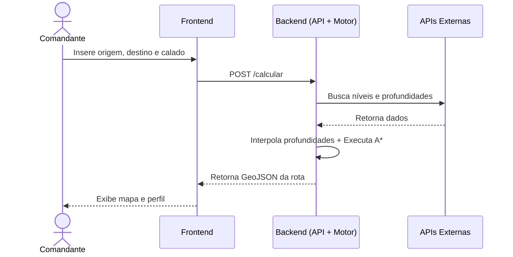
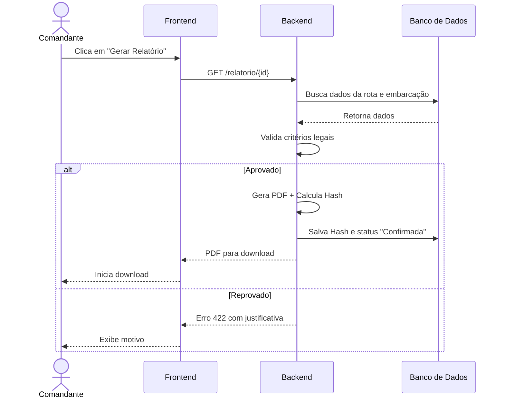
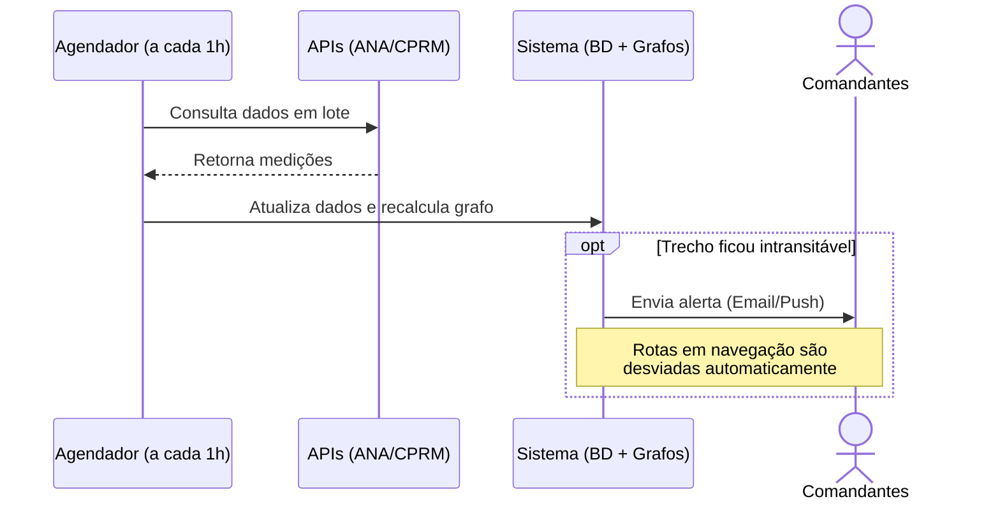
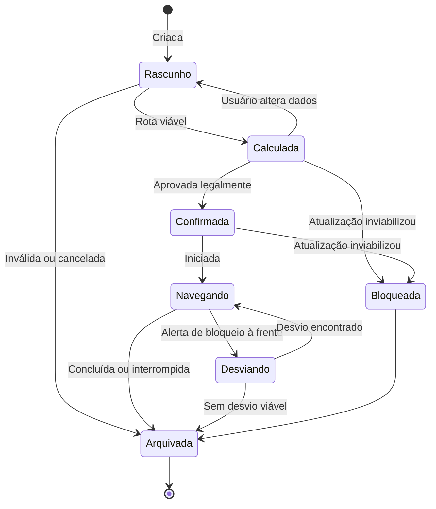
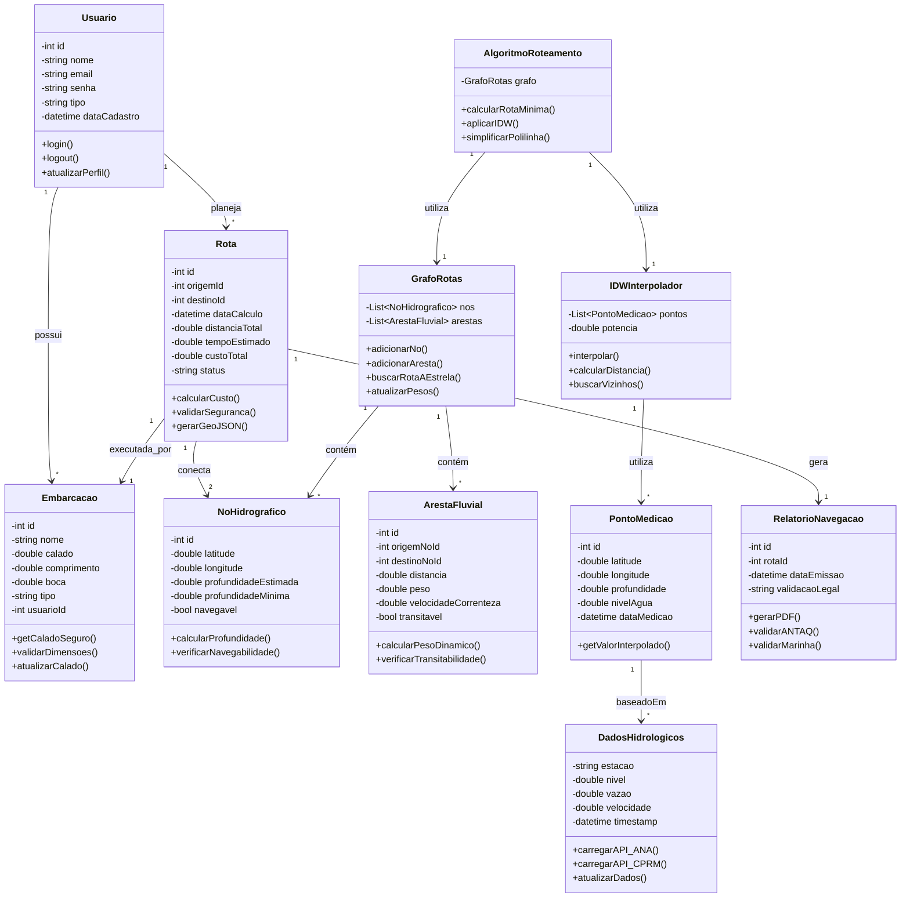
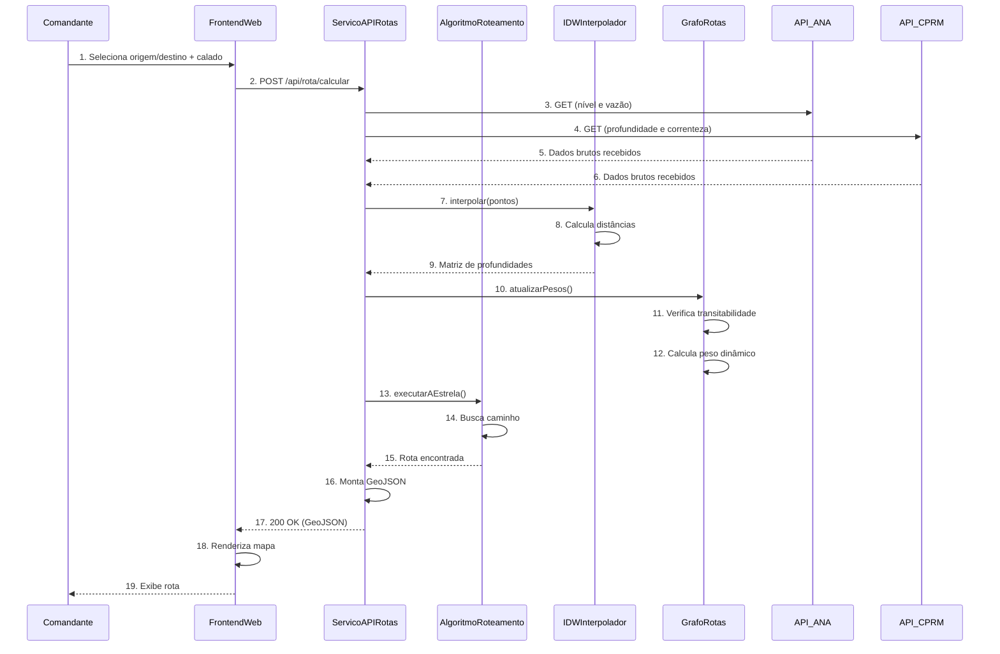

# Modelagem do Sistema Ygapé

### 3.1. Fluxo de Cálculo de Rota

### 3.2. Fluxo de Geração de Relatório

### 3.3. Fluxo de Atualização Automática

### 5. Visão de Estados: Ciclo de Vida da Rota

## 1. Diagrama de Classes

## 1. Diagrama de Sequência
