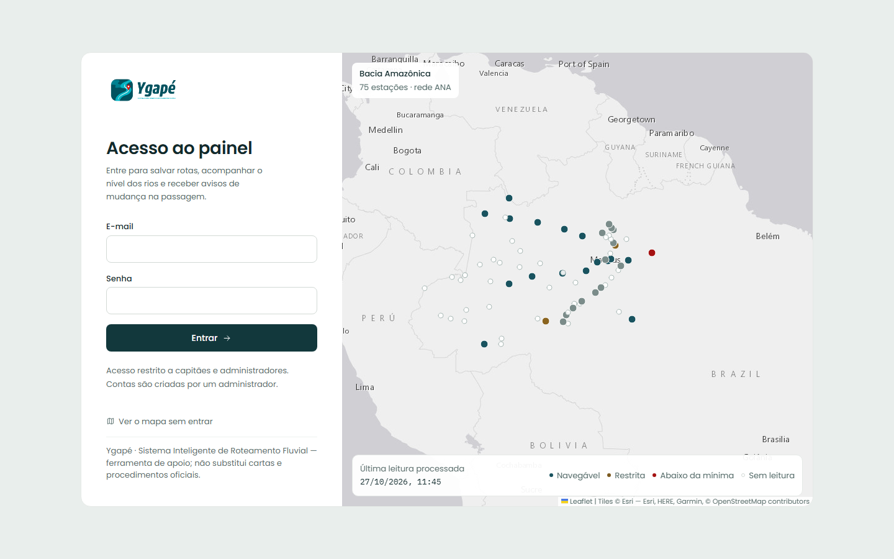
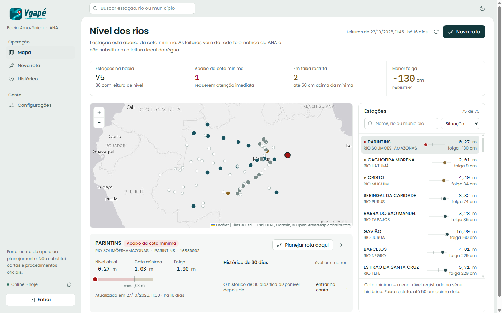
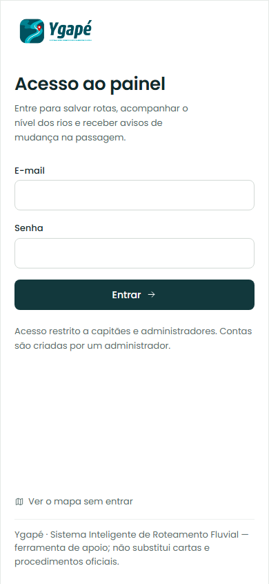
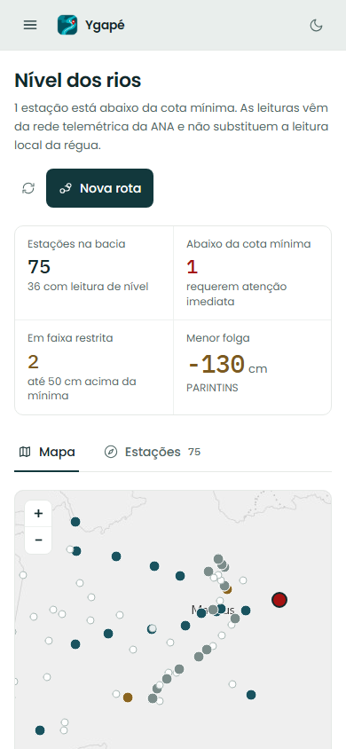

# 🌊 YGAPÉ — SISTEMA INTELIGENTE DE ROTEAMENTO FLUVIAL

Plataforma web interativa para planejamento de rotas fluviais na bacia amazônica. Calcula o
trajeto mais rápido e seguro nos rios do Amazonas, considerando o nível do rio, o calado da
embarcação e a margem de segurança. O sistema reúne dados hidrológicos da ANA, mapa interativo,
autenticação de usuários e administração em uma única aplicação.

Comandantes, empresas de logística fluvial e defesa civil usam o Ygapé para decidir rotas com
segurança e previsibilidade durante a seca e a cheia.

- **Acesso:** https://ygape.aquacode.dev.br
- **Documentação da API:** https://ygape.aquacode.dev.br/api/v1/docs
- **Repositório:** https://github.com/TolkYo/TCC_Ygape

## 📸 Capturas de Tela

### Tela de Login



### Mapa de estações fluviais



### Versão mobile

<p>
  
  
</p>

## ✅ Funcionalidades

- ✅ Autenticação de usuários com login e token JWT
- ✅ Controle de sessão, perfis de acesso e proteção de rotas
- ✅ Gerenciamento de usuários e permissões
- ✅ Mapa interativo com estações fluviais monitoradas pela ANA
- ✅ Consulta de nível atual, mínima histórica e situação de cada estação
- ✅ Cálculo de rotas fluviais por nível do rio, calado e margem de segurança
- ✅ Histórico de rotas e monitoramento de alterações
- ✅ Coleta e atualização de dados hidrológicos
- ✅ Administração de usuários, coletas e logs
- ✅ Funcionamento offline com cache local e sincronização
- ✅ Notificações em tempo real via WebSocket
- ✅ Design responsivo com a identidade visual Ygapé
- ✅ API documentada com FastAPI e Swagger

## 🧩 Estrutura do Projeto

```text
TCC-Ygape/
├── backend/                    # API FastAPI, roteamento e coletores
│   ├── main.py                 # Aplicação, endpoints e WebSocket
│   ├── db.py                   # Conexão PostgreSQL/PostGIS
│   ├── routing_engine.py       # Motor de cálculo de rotas
│   ├── carregar_postgis.py     # ETL SQLite -> PostGIS
│   └── coletar_*.py            # Coletores de dados da ANA
├── frontend/                   # Aplicação Vue 3 + Vite + TypeScript
│   ├── public/
│   │   ├── brand/              # Logos e ícone da marca
│   │   └── fonts/              # Poppins e Akko Pro
│   └── src/
│       ├── views/              # Login, mapa, rotas e administração
│       ├── components/         # Mapa, botões e badges
│       ├── stores/             # Estado com Pinia
│       ├── services/           # HTTP, cache e roteamento
│       └── layouts/            # Layout principal
├── data/                       # Bases SQLite geradas pela coleta
├── deploy/swarm/               # Stack Docker Swarm + Traefik + nginx
├── docs/                       # Especificações, diagramas e relatórios
├── .env.example                # Modelo de variáveis de ambiente
└── README.md                   # Este arquivo
```

## 🛠 Tecnologias Utilizadas

| Tecnologia | Descrição |
| --- | --- |
| Python 3.14 + FastAPI | API REST, autenticação e WebSocket |
| PostgreSQL 16 + PostGIS 3.4 | Banco geoespacial da aplicação e dos dados hidrológicos |
| Vue 3 + TypeScript | Interface web reativa e tipada |
| Vite | Desenvolvimento e build do frontend |
| Tailwind CSS 4 | Estilização e responsividade |
| Leaflet | Mapa interativo das estações fluviais |
| Pinia + Vue Router | Gerenciamento de estado e navegação |
| IndexedDB (Dexie) | Cache local e funcionamento offline |
| Vitest | Testes automatizados do frontend |
| Docker Swarm + Traefik + nginx | Publicação em produção |

## ⚙ Pré-requisitos

- Python 3.14
- Node.js 24 (ou compatível)
- Acesso ao PostgreSQL/PostGIS da aplicação
- Chave SSH para o túnel do banco (ambiente local)
- Navegador web moderno
- Editor de código (recomendado: VS Code)

## ⚙ Configuração

1. Clone o repositório:

   ```powershell
   git clone https://github.com/TolkYo/TCC_Ygape.git
   cd TCC_Ygape
   ```

2. Crie o ambiente virtual e instale as dependências:

   ```powershell
   python -m venv .venv
   .\.venv\Scripts\python.exe -m pip install -r backend\requirements.txt
   ```

3. Crie o `.env` a partir do modelo e preencha as credenciais do banco:

   ```powershell
   Copy-Item .env.example .env
   ```

   O backend usa **PostgreSQL/PostGIS**. A base `data/hidrowize.db` é usada pelos coletores e
   alimenta o PostGIS pelo ETL `backend/carregar_postgis.py`; a API não lê SQLite diretamente.

4. Gere o segredo de autenticação e preencha `HIDROWIZE_TOKEN_SECRET`:

   ```powershell
   python -c "import secrets; print(secrets.token_urlsafe(48))"
   ```

5. Crie o primeiro acesso administrativo, a partir de `backend`:

   ```powershell
   cd backend
   ..\.venv\Scripts\python.exe criar_admin.py --nome "Administrador" --email admin@ygape.local
   ```

## 🚦 Como Executar o Projeto

### Opção 1: Ambiente completo (API + frontend)

1. Abra o túnel SSH para o banco da VPS (o IP está no `.env`):

   ```powershell
   ssh -L 5432:127.0.0.1:5432 root@<IP_DA_VPS>
   ```

2. Em outro terminal, suba a API a partir de `backend`:

   ```powershell
   cd backend
   ..\.venv\Scripts\python.exe -m uvicorn main:app --reload
   ```

3. Em um terceiro terminal, suba o frontend:

   ```powershell
   cd frontend
   npm install
   Copy-Item .env.example .env
   npm run dev
   ```

4. Acesse **http://localhost:5173**. A API estará em
   **http://localhost:8000/api/v1/docs**.

### Opção 2: Somente o frontend

Com uma API acessível (local ou publicada), configure `VITE_API_BASE_URL` em `frontend/.env`:

```powershell
cd frontend
npm install
Copy-Item .env.example .env
npm run dev
```

Comandos úteis: `npm run build`, `npm run typecheck`, `npm run lint` e `npm run test:run`.

## 📋 Funcionalidades Detalhadas

### Autenticação

- Login com e-mail e senha e emissão de token JWT
- Restauração de sessão e logout
- Perfis de acesso (piloto e administrador)
- Proteção de rotas autenticadas no frontend e na API

### Mapa e estações

- Mapa interativo com as estações fluviais monitoradas pela ANA
- Busca por nome da estação, rio ou município
- Exibição do nível atual, mínima histórica e situação da estação
- Indicação visual de estações em atenção ou sem dados

### Rotas

- Cálculo de rota considerando nível do rio, calado e margem de segurança
- Estimativa de distância e tempo pela velocidade da embarcação
- Visualização do trajeto no mapa
- Histórico de rotas calculadas
- Monitoramento de alterações e avisos em tempo real

### Administração

- Gerenciamento de usuários e permissões
- Execução e acompanhamento de coletas de dados
- Consulta de logs da aplicação

### Offline e sincronização

- Cache local de estações e rotas
- Sincronização quando a conexão é restabelecida
- Notificações via WebSocket e indicador de estado online/offline

## 🚀 Publicação

O frontend está publicado em **https://ygape.aquacode.dev.br** pela stack `ygape-app` (nginx),
que serve o build estático e encaminha `/api/` para a API. A API e o banco ficam na stack
`ygape`, sem exposição pública.

```powershell
# 1. Build do frontend (API_BASE_URL relativo: /api/v1)
cd frontend
npm run build

# 2. Empacotar o build
tar -C dist -czf "$env:TEMP\ygape-dist.tar.gz" .

# 3. Enviar o pacote para a VPS
scp "$env:TEMP\ygape-dist.tar.gz" root@<IP_DA_VPS>:/tmp/ygape-dist.tar.gz
```

Na VPS, extraia em uma pasta temporária e sincronize o conteúdo sem reiniciar a stack:

```bash
rm -rf /tmp/ygape-web-new
mkdir -p /tmp/ygape-web-new
tar -xzf /tmp/ygape-dist.tar.gz -C /tmp/ygape-web-new
rsync -a --delete /tmp/ygape-web-new/ /opt/ygape/web/
rm -rf /tmp/ygape-web-new /tmp/ygape-dist.tar.gz
```

O conteúdo de `/opt/ygape/web` é servido por bind mount, portanto atualizações de frontend não
exigem redeploy. Recomenda-se gerar um backup do diretório antes da sincronização. Se o arquivo
`deploy/swarm/web-nginx.conf` mudar, envie-o para `/opt/ygape/nginx.conf` e recarregue o serviço
`ygape-app_web`. Modelos: `deploy/swarm/ygape.yml.example` (DB + API) e
`deploy/swarm/ygape-app.yml` (nginx + Traefik). O arquivo com segredos (`ygape.yml`) fica apenas
na VPS.

```bash
docker stack deploy -c ygape-app.yml ygape-app   # site
docker stack deploy -c ygape.yml ygape           # DB + API
```

## 👤 Autor

[TolkYo](https://github.com/TolkYo)
