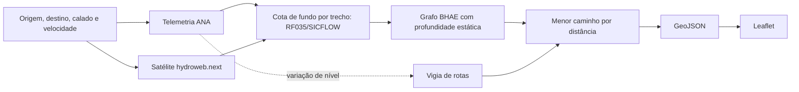

# YGAPÉ — Sistema de Roteamento Fluvial Dinâmico

## Resumo Executivo Revisado

**Versão:** 2.0 (revisada a partir do documento “Resumo Executivo - Sistema Ygapé.pdf”)
**Data da auditoria:** 28/10/2026
**Base de verificação:** código-fonte do repositório e banco `data/hidrowize.db`
**Finalidade:** substituir o resumo anterior por dados compatíveis com a implementação observada.

> **Critério adotado:** somente foi classificado como **implementado** o que possui código e/ou dados verificáveis no repositório. Itens sem evidência local foram marcados como **não comprovados**, e não como concluídos. Números do banco referem-se ao snapshot local de 28/10/2026; a base de produção no PostgreSQL/PostGIS deve ser conferida separadamente.

---

## 1. Contexto e problema central

A navegação fluvial na bacia amazônica é condicionada pelo pulso de inundação sazonal. Na estiagem surgem bancos de areia e pedrais; na cheia, a calha se expande sobre áreas de várzea. Aplicativos de trânsito urbano não modelam a dinâmica fluviométrica e não respondem à pergunta operacional do comandante: **qual trajeto permanece navegável e seguro para um determinado calado de embarcação**.

O Ygapé se propõe a apoiar essa decisão combinando:

- rede hidrográfica georreferenciada;
- níveis d'água observados e estimados;
- estimativa de cota de fundo;
- cálculo de rota sobre um grafo;
- visualização da rota e monitoramento de alterações.

O sistema é **suporte decisório**: não substitui a carta náutica oficial, os procedimentos da Marinha do Brasil nem a avaliação do comandante.

---

## 2. Validação e impacto social — pesquisa de campo

Os percentuais abaixo constam do resumo original como resultados de pesquisa de campo dos autores. **Não há, no repositório, planilha, questionário, amostra ou relatório estatístico que permita auditá-los.** Recomenda-se anexar o instrumento e a caracterização da amostra ao TCC.

| Indicador | Percentual | Natureza |
|---|---:|---|
| Relataram atrasos ou alterações forçadas de rota no transporte | 90% | Dado primário dos autores; não auditável no repositório |
| Classificaram como crítico o impacto do ciclo hídrico na mobilidade | 91% | Dado primário dos autores; não auditável no repositório |
| Avaliaram como indispensável um aplicativo de navegação fluvial | 81% | Dado primário dos autores; não auditável no repositório |

---

## 3. O que o sistema implementa hoje

### 3.1 Coleta e consolidação de dados

- Coletores da ANA via SOAP e via API REST Hidro Web Service.
- Coletor de produtos de satélite hydroweb.next (CNES/LEGOS): altimetria, batimetria SWOT/SICFLOW e vazão.
- Coletor de decretos estaduais de emergência.
- ETL do SQLite consolidado para PostgreSQL/PostGIS.
- Geração de indicadores derivados: navegabilidade, séries semanais, histórico geográfico e cota de fundo por trecho.

### 3.2 Roteamento

- Grafo construído a partir dos trechos navegáveis da BHAE, com adjacência bidirecional.
- Busca de menor caminho por **distância** com fila de prioridade (`heapq`), podando arestas cuja profundidade estática seja menor que `calado + margem de segurança`.
- **Não é A\*** e **não otimiza tempo**: o tempo é calculado depois, como `distância / velocidade`.
- A profundidade usada no cálculo é o atributo estático `hig_drn_depth_m` da BHAE, carregado uma única vez em memória.

Referências: `backend/routing_engine.py:76` e `backend/routing_engine.py:116`.

### 3.3 Interface web

- Aplicação Vue 3 + TypeScript + Vite, com Tailwind CSS 4, Pinia e Leaflet.
- Login, mapa de estações, planejamento de rota, histórico, configurações e telas administrativas.
- Resumo da rota com distância, tempo, profundidade mínima e trechos críticos.
- PWA com service worker, cache de assets/API, persistência local em Dexie/IndexedDB e roteador local simplificado para uso offline.
- Notificações em tempo real por WebSocket e fallback por polling.

### 3.4 Monitoramento de rotas

- Rotina de vigia a cada **15 minutos** por padrão (`HIDROWIZE_MONITOR_INTERVALO_MIN`), configurável por ambiente.
- Limiar padrão de variação: **30 cm**; cooldown: **30 min**; evento extremo: **≥ 100 cm**.
- Recalcula o traçado, registra `rota_alteracao` e publica o evento `rota_alterada` por WebSocket.
- **Não há** notificação por e-mail ou push.
- **Não há** estado de rota `DESVIANDO`.

Referências: `backend/main.py:42`, `backend/main.py:811` e `backend/main.py:900`.

---

## 4. Escala e fontes de dados — números verificados

### 4.1 Rede hidrográfica e estações

| Ativo | Quantidade verificada | Observação |
|---|---:|---|
| Trechos da BHAE nacional | 481.135 | Base oficial usada no projeto |
| Trechos navegáveis recortados | **121.661** | Recorte Federal + Internacional + Estadual com Strahler ≥ 4 |
| Trechos federais | 22.926 | Recorte específico |
| Estações ANA cadastradas | **75** | Universo do Amazonas usado no estudo |
| Estações ANA com telemetria | 69 | Nem todas as 75 são telemétricas |
| Rios catalogados | 14.135 | Catálogo ANA |
| Decretos de emergência | 144 | Base estadual |

> O número **362.419 trechos da “BHO6”** não foi reproduzido no repositório. A base antiga BHO 2017 foi substituída pela BHAE; o recorte efetivamente versionado e usado no roteamento é de 121.661 trechos. Ver `mapeamento_fontes.md:325`.

### 4.2 Séries hidrológicas e satélite

| Tabela | Registros | Conteúdo |
|---|---:|---|
| `telemetria` | 128.237 | Leituras ANA no snapshot (20/07/2026 a 17/08/2026) |
| `cotas_diarias` | 74.356 | Série diária de cotas (01/01/2022 a 31/05/2026) |
| `cotas_historicas` | 75 | Mínimo, máximo e média por estação |
| `nivel_semanal` | 10.790 | Agregação semanal por estação |
| `estacoes_virtuais` | 4.734 | Estações virtuais hydroweb.next |
| `series_nivel_satelite` | 590.698 | Observações de nível por altimetria |
| `batimetria_sicflow` | 1.315.079 | Nós de seção transversal SWOT/SICFLOW |
| `series_vazao_satelite` | 475.111 | Observações de vazão SWOT |
| `cota_fundo_trecho` | 121.661 | Cota de fundo estimada por trecho |
| `cota_fundo_trecho` com valor observado | 42.721 | Trechos com referência SICFLOW próxima |

### 4.3 Itens não comprovados

| Item do resumo anterior | Situação no repositório |
|---|---|
| 86 cartas náuticas raster em GeoTIFF | Existe apenas o extrator `backend/extrair_sondagens_carta.py`; não há GeoTIFFs nem contagem versionada |
| 145 instalações portuárias da ANTAQ | Não há tabela, planilha ou carga correspondente; o planejador usa estações ANA como âncoras |
| Integração com CPRM | Não há cliente ou coleta CPRM no código |
| Integração de telemetria com a CHM | A CHM aparece apenas como fonte de cartas; não há telemetria CHM |

---

## 5. Arquitetura tecnológica real

| Camada | Tecnologia efetiva | Responsabilidade |
|---|---|---|
| Backend | Python 3.10+ (contêiner em 3.12), FastAPI, Uvicorn, psycopg2 | API REST, autenticação, regras e monitoramento |
| Banco | **PostgreSQL + PostGIS** | Persistência de usuários, rotas, trechos, séries e satélite |
| Grafo | Implementação própria com `heapq` | Adjacência bidirecional e menor caminho por distância |
| Geoespacial/ML | NumPy, Shapely, scikit-learn | Cota de fundo, interpolação e análises |
| Frontend | Vue 3.5, Vite 8, TypeScript, Tailwind CSS 4, Pinia, Leaflet | Interface, mapa, rota, offline e administração |
| Offline | Dexie/IndexedDB + Service Worker | Cache, fila de sincronização e rota local simplificada |
| Deploy | Docker Swarm + Traefik + nginx | Publicação em `ygape.aquacode.dev.br` |
| Testes | Vitest no frontend | 12 arquivos e 44 testes verdes em 28/10/2026 |

### 5.1 Correções em relação ao resumo anterior

| Resumo anterior | Dado correto |
|---|---|
| MySQL no servidor | PostgreSQL/PostGIS |
| SQLite como banco local da aplicação | SQLite é armazenamento da coleta; a aplicação usa PostgreSQL |
| NetworkX e MultiDiGraph | Grafo próprio, bidirecional, com `heapq` |
| A\* por menor tempo | Dijkstra por distância; tempo calculado a posteriori |
| SciPy, Pyproj e Rasterio na interpolação | Não constam nas dependências de produção; IDW usa NumPy e é apenas baseline experimental |
| IDW em produção | Produção usa RandomForest (`RF035`) para cota de fundo; IDW aparece em `interpolar_nivel.py` como comparação |
| HTML5/JS + Bootstrap 5.3 + Chart.js | Vue 3 + TypeScript + Tailwind + Leaflet; Bootstrap e Chart.js existem apenas no protótipo legado |
| Agendador de 60 minutos | Vigia de rotas a cada 15 minutos por padrão; não há scheduler de coleta de 60 min no deploy |
| Notificação por e-mail ou push | Apenas WebSocket com o app online; sem SMTP e sem push |
| Estado `DESVIANDO` | Não existe; há o evento `rota_alterada` e o campo booleano `monitorar` |
| JWT | Token Bearer próprio, assinado com HMAC-SHA256; não segue o formato JWT `header.payload.signature` |

---

## 6. Fluxo real de processamento



**Ponto crítico:** o nível d'água participa do gatilho de verificação, mas **não altera o peso das arestas**. Como a profundidade permanece estática e o grafo fica em cache, o recálculo tende a devolver sempre o mesmo traçado. O ciclo de “rota que muda com a seca/cheia” ainda não está fechado.

---

## 7. Status por capacidade

| Capacidade | Status | Evidência |
|---|---|---|
| Coleta ANA (SOAP/REST) | Implementado | `backend/ana_soap.py`, `backend/ana_client.py` |
| Coleta hydroweb.next/SWOT | Implementado | `backend/coletar_hydroweb.py` |
| Carga no PostgreSQL/PostGIS | Implementado | `backend/carregar_postgis.py` |
| Grafo sobre trechos reais | Implementado | `backend/routing_engine.py` |
| Rota por distância com poda por calado | Implementado | `backend/routing_engine.py:116` |
| Rota por tempo e correnteza | Parcial | Fórmula prevista; peso não implementado |
| A\* com heurística | Não implementado | Busca atual é Dijkstra |
| Profundidade dinâmica `nível − cota de fundo` | Parcial | Cota de fundo existe; datum vertical e integração pendentes |
| IDW em produção | Não implementado | Apenas baseline em `backend/interpolar_nivel.py:71` |
| Cota de fundo por ML | Implementado | `backend/treinar_cota_fundo.py`; MAE 6,9 m |
| Autenticação e papéis | Implementado | Token HMAC + scrypt; perfis admin/piloto |
| Proteção de todos os endpoints | Parcial | `/rotas/calcular` e `/estacoes` são públicos |
| Mapa e rota no Leaflet | Implementado | `frontend/src/components/map/RiverMap.vue` |
| Offline e sincronização | Implementado | Dexie, service worker, snapshot e rota local |
| Vigia de rotas | Implementado | `backend/main.py:811` |
| Notificação WebSocket | Implementado | `backend/main.py:1082` |
| E-mail/push | Não implementado | Sem SMTP ou serviço de push |
| Estado `DESVIANDO` | Não implementado | Sem máquina de estados de rota |
| 86 cartas GeoTIFF | Não comprovado | Sem dados versionados |
| 145 portos ANTAQ | Não comprovado | Sem tabela ou carga |
| Testes automatizados do backend | Não implementado | Não há suíte `pytest` no repositório |

---

## 8. Limitações e pendências críticas

1. **Datum vertical inconsistente.** A cota da régua ANA (cm, referida ao zero da régua) não está na mesma referência da cota de fundo (m, referida ao geoide). A igualdade `profundidade = nível − cota_fundo` ainda não é confiável.
2. **Roteamento não dinâmico.** O motor usa profundidade estática da BHAE; sem recalcular a profundidade por nível, a rota não responde à seca/cheia.
3. **Custo não é tempo.** Velocidade da embarcação e correnteza não entram no peso; o tempo é derivado da distância.
4. **Conectividade da rede.** Persistem riscos de pontas soltas, duplicatas e trechos desconexos no corredor.
5. **Posição das estações.** Estações podem estar deslocadas do canal (até cerca de 3 km), afetando a associação estação–trecho.
6. **Cobertura de cota de fundo.** Há valor observado em 42.721 dos 121.661 trechos; o restante depende de estimativa com MAE de 6,9 m.
7. **Segurança.** `/rotas/calcular` e `/estacoes` não exigem autenticação; a decisão de mantê-los públicos precisa ser formalizada.
8. **Validação acadêmica.** Faltam testes de backend, medição formal de desempenho e evidência versionada da pesquisa de campo.

---

## 9. Referências internas

- `backend/routing_engine.py` — grafo, profundidade estática e menor caminho.
- `backend/main.py` — API, autenticação, vigia, WebSocket e snapshot offline.
- `backend/interpolar_nivel.py` — IDW como baseline experimental.
- `backend/treinar_cota_fundo.py` — modelo de cota de fundo (RF035).
- `backend/coletar_hydroweb.py` — coleta SWOT/SICFLOW e altimetria.
- `backend/db.py` — conexão PostgreSQL/PostGIS.
- `backend/extrair_sondagens_carta.py` — extrator de cartas raster.
- `frontend/package.json` — dependências reais do frontend.
- `frontend/public/sw.js` — service worker e cache.
- `deploy/swarm/ygape-app.yml` — publicação com nginx e Traefik.
- `mapeamento_fontes.md` — fontes, recortes e resultados de ML.
- `docs/specs/estado-atual-projeto.md` — status detalhado dos requisitos.
- `data/hidrowize.db` — base consolidada usada nas contagens deste documento.

---

## 10. Como reproduzir as contagens

```powershell
# Contagens do banco consolidado
.\.venv\Scripts\python.exe -c "import sqlite3; c=sqlite3.connect(r'data\hidrowize.db'); print(c.execute('select count(*) from trechos_navegaveis').fetchone()[0])"

# Testes do frontend
cd frontend
npm run test:run
```

Resultado observado em 28/10/2026: **12 arquivos de teste e 44 testes aprovados** no frontend; `compileall` do backend sem erros de sintaxe. **Não existe suíte de testes automatizados do backend.**

---

## 11. Conclusão

O projeto possui base técnica consistente: dados hidrológicos e de satélite em volume relevante, API funcional, grafo sobre a rede real, aplicação web com mapa e offline, e monitoramento por WebSocket. Entretanto, o resumo anterior descrevia como concluído o núcleo diferencial — **IDW + A\* + profundidade dinâmica + rota que muda com o nível** — que ainda está parcial ou não implementado.

Para fins de TCC e de avaliação externa, este documento deve prevalecer sobre o PDF anterior. As afirmativas de conformidade com NORMAM-224/DPC e PIANC também não possuem evidência de validação no repositório; a única referência normativa efetivamente documentada é o calado de projeto por tramo DNIT/ANTAQ (RN029).
