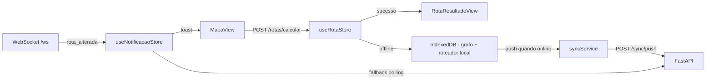

# Componentes Frontend

## Arvore de Componentes

```
src/
├── App.vue
├── main.ts
├── router/
│   └── index.ts
├── stores/
│   ├── useAuthStore.ts
│   ├── useRotaStore.ts
│   ├── useNivelStore.ts
│   └── useOfflineStore.ts
├── services/
│   ├── api.ts          # Cliente axios (interceptor JWT)
│   ├── anna.ts         # Wrapper endpoints backend
│   └── sync.ts         # Logica de sincronizacao
├── db/
│   └── index.ts        # Dexie.js (IndexedDB)
├── layouts/
│   ├── DefaultLayout.vue
│   ├── AuthLayout.vue
│   └── AdminLayout.vue
├── views/
│   ├── LoginView.vue
│   ├── MapaView.vue
│   ├── RotaFormView.vue
│   ├── RotaResultadoView.vue
│   ├── HistoricoView.vue
│   ├── EstacoesView.vue
│   └── admin/
│       ├── UsuariosView.vue
│       ├── ColetaView.vue
│       └── LogsView.vue
└── components/
    ├── ui/
    │   ├── BaseButton.vue
    │   ├── BaseModal.vue
    │   ├── BaseInput.vue
    │   ├── SpinnerSkeleton.vue
    │   └── StatusBadge.vue
    ├── mapa/
    │   ├── RiverMap.vue
    │   ├── EstacaoMarker.vue
    │   ├── RotaOverlay.vue
    │   └── LegendaNivel.vue
    └── rota/
        ├── RotaForm.vue
        ├── RotaResumo.vue
        └── RotaTrechosTable.vue
```

## Rotas

| Path | Componente | Auth | Guard |
|------|-----------|------|-------|
| /login | LoginView | Nao | redirect se logado |
| / | MapaView | Sim | - |
| /rota | RotaFormView | Sim | - |
| /rota/:id | RotaResultadoView | Sim | - |
| /historico | HistoricoView | Sim | - |
| /estacoes | EstacoesView | Sim | - |
| /admin/usuarios | UsuariosView | admin | requireRole('admin') |
| /admin/coleta | ColetaView | admin | requireRole('admin') |
| /admin/logs | LogsView | admin | requireRole('admin') |

## Stores (estado global)

- **useAuthStore**: `usuario`, `token`, `login()`, `logout()`, `isAuthenticated()`, `hasRole('admin')`
- **useRotaStore**: `rotaAtual`, `historico[]`, `loading`, `error`, `calcular(origem, destino, calado, velocidade)`, `carregarHistorico()`
- **useNivelStore**: `estacoes[]`, `niveis`, `loading`, `buscarEstacoes()`, `carregarNiveis()`
- **useOfflineStore**: `online`, `ultimaSincronizacao`, `pendentes[]`, `iniciarSincronizacao()`
- **useNotificacaoStore**: `canalWS`, `eventos[]`, `conectar()`, `onRotaAlterada()`, `fallbackPolling()`

## Servicos extras

- `services/roteador.ts` — **A* local (JS)** usado offline sobre o grafo do snapshot (RF022/RN026);
  aplica RN010 (transitabilidade), RN011 (custo por tempo) e RN022 (profundidade)
- `services/websocket.ts` — cliente WebSocket com reconexao automatica; fallback para polling (RN027)

## Servicos e Offline (Dexie.js)

- Tabelas IndexedDB:
  - `estacoes_cache` — snapshot das estacoes
  - `niveis_cache` — ultimas leituras
  - `profundidades_cache` — profundidades por aresta
  - `rotas_locais` — rotas calculadas offline (pendentes de push)
  - `logs_locais` — logs de uso offline
- **Service Worker** (estratégia *stale-while-revalidate*):
  - Precache de assets do app (build)
  - Rotas de API: resposta do cache primeiro, atualiza em segundo plano
- **Conexao**: evento `online`/`offline` → dispara `useOfflineStore.iniciarSincronizacao()`
- **Criptografia**: campos sensiveis (ex: rotas com calado) cifrados via WebCrypto (AES-GCM) antes de gravar em IndexedDB

## Interacoes com o Backend


