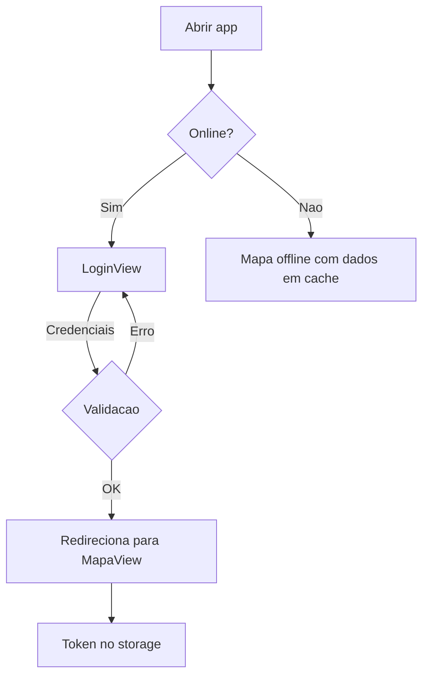
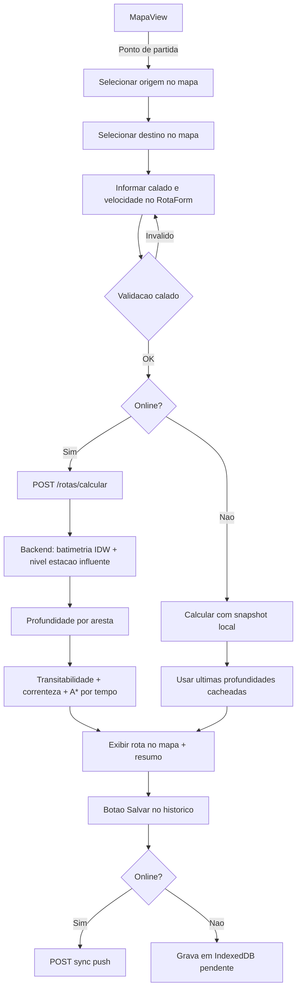
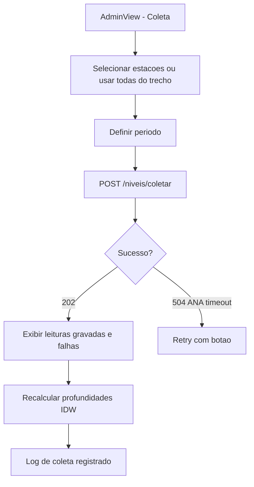
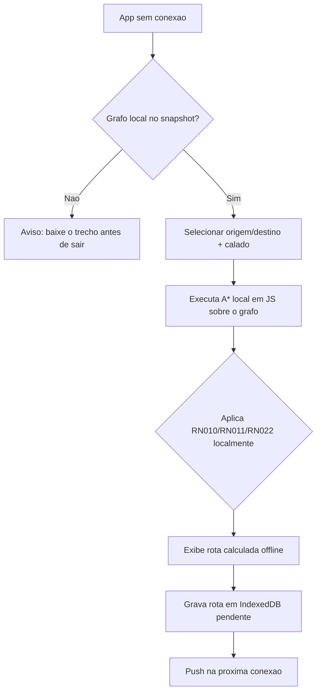

# Fluxos de UX

## Fluxo: Login



### Estados da Tela
| Estado | Gatilho | Comportamento |
|--------|---------|---------------|
| Vazio | Sem token | Exibir formulario de login |
| Erro | Credenciais invalidas | Mensagem de erro inline |
| Sucesso | Token recebido | Salvar JWT, navegar para / |

---

## Fluxo: Calcular Rota



### Estados da Tela
| Estado | Gatilho | Comportamento |
|--------|---------|---------------|
| Selecao | Clique no mapa | Marca origem/destino com pins |
| Carregando | Requisicao de rota | Skeleton + spinner no resumo |
| Erro | Rota nao encontrada | Toast "Trecho intransitavel para o calado" |
| Offline | Sem conexao | Badge "Dados de [data]" + aviso de snapshot |
| Sucesso | Rota calculada | Polilinha verde no mapa + tabela de trechos |

---

## Fluxo: Sincronizacao Automatica

```mermaid
graph TD
    A[App online detectado] --> B[Service Worker registra conexao]
    B --> C[pull: GET /sync/snapshot]
    C --> D[Atualizar estacoes/niveis/profundidades cache]
    D --> E[push: POST /sync/push]
    E --> F{Conflitos?}
    F -->|Sim| G[Manter mais recente + log]
    F -->|Nao| H[Limpar pendentes locais]
    G --> H
    H --> I[Notificar "Sincronizado em [hora]"]
```

---

## Fluxo: Coleta de Dados ANA (admin)



### Estados da Tela
| Estado | Gatilho | Comportamento |
|--------|---------|---------------|
| Inicial | Abrir pagina | Formulario com estacoes do trecho |
| Processando | Coleta em execucao | Progressbar + contagem |
| Concluido | Resposta 202 | Resumo (coletadas/gravadas/falhas) |
| Erro | Falha ANA | Mensagem + opcao de tentar novamente |

---

## Fluxo: Gerenciar Usuarios (admin)

```mermaid
graph TD
    A[AdminView - Usuarios] --> B[Lista de usuarios]
    B --> C[Criar novo usuario]
    C --> D[Form: nome, email, senha, papel]
    D --> E{Validacao}
    E -->|OK| F[POST /usuarios]
    E -->|Erro| D
    B --> G[Editar usuario]
    G --> H[Alterar papel / desativar]
    H --> I[PUT /usuarios/{id}]
```

---

## Fluxo: Monitoramento de Rota (Variacao do Nivel)

```mermaid
graph TD
    A[Rota calculada] --> B{Ativar monitoramento?}
    B -->|Sim| C[POST /rotas/{id}/monitorar]
    B -->|Nao| D[Rota comum, sem alertas]
    C --> E[Backend monitora novas leituras ANA]
    E --> F{Variacao >= 30cm?}
    F -->|Nao| G[Atualiza nivel apenas]
    F -->|Sim| H{Cooldown 30min ok?}
    H -->|Nao| I{Evento extremo >= 100cm?}
    I -->|Sim| J[Recalcula imediatamente]
    I -->|Nao| G
    H -->|Sim| J
    J --> K[IDW + A* recalculados]
    K --> L{Tracado mudou?}
    L -->|Sim| M[Grava ROTA_ALTERACAO + publica evento WS]
    L -->|Nao| N[Atualiza profundidades, rota mantida]
    M --> O{App online?}
    O -->|Sim| P[WebSocket entrega toast em tempo real]
    O -->|Nao| Q[Notificacao aplicada na proxima sync]
    P --> R[Piloto visualiza nova rota no mapa]
    Q --> R
```

### Estados da Tela
| Estado | Gatilho | Comportamento |
|--------|---------|---------------|
| Monitorando | Rota com `monitorar=true` | Badge "Monitorando nível" + ícone de sino ativo |
| Variacao baixa | Nivel < 30cm | Atualiza nível em silêncio |
| Rota alterada | Recomputacao mudou tracado | Toast "Rota alterada — novo traçado disponível" |
| Evento extremo | Variacao >= 100cm | Notificação prioritária + recalculo imediato |
| Cooldown | Recalculo recente (< 30min) | Aviso "Reavaliando em breve" |
| Offline | Sem WS | Aviso "Alterações serão baixadas na próxima sincronização" |

---

## Fluxo: Calculo Offline (Recalculo Local)



### Estados da Tela
| Estado | Gatilho | Comportamento |
|--------|---------|---------------|
| Sem grafo | Snapshot nao baixado | Banner "Baixe o trecho para uso offline" |
| Calculando | A* local | Spinner rápido (grafo leve do trecho) |
| Sucesso | Rota local | Badge "Calculada offline [data]" |
| Erro | Fora do subgrafo | Toast "Rota indisponível offline" |

---

## Regras de Feedback (global)

| Evento | Feedback |
|--------|----------|
| Rotas disponiveis | Polilinha destacada + borda animada |
| Trecho critico | Marcador amarelo/vermelho no mapa |
| Estacao com dado desatualizado | Badge cinza ">24h" |
| Sincronizacao concluida | Toast verde "Dados atualizados" |
| Falha de rede na API | Toast "Sem conexao — usando dados locais" |
| Login expirado (401) | Redireciona para /login com aviso |
