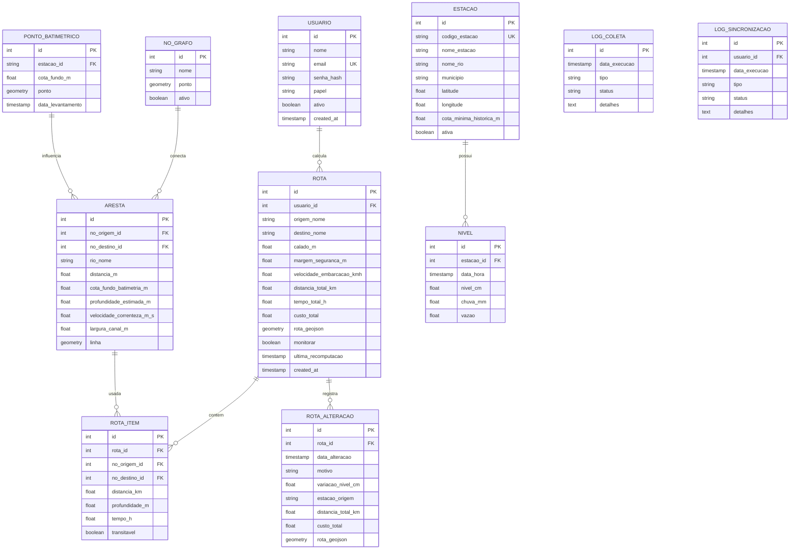

# Modelo de Dados

## Diagrama Entidade-Relacionamento

## Entidades

### USUARIO
| Coluna | Tipo | Restricoes | Descricao |
|--------|------|-----------|-----------|
| id | int | PK, AUTO_INCREMENT | Identificador unico |
| nome | varchar(120) | NOT NULL | Nome completo |
| email | varchar(180) | NOT NULL, UNIQUE | Email de login |
| senha_hash | varchar(255) | NOT NULL | Hash bcrypt da senha |
| papel | enum('admin','piloto') | NOT NULL, DEFAULT 'piloto' | Papel de acesso |
| ativo | boolean | NOT NULL, DEFAULT TRUE | Usuario habilitado |
| created_at | timestamp | DEFAULT NOW() | Data de criacao |

**Indices**: `idx_usuario_email` em `email` (motivo: lookup no login).
**Relacionamentos**:
- `USUARIO 1..N ROTA`: usuario calcula varias rotas.

### ESTACAO
| Coluna | Tipo | Restricoes | Descricao |
|--------|------|-----------|-----------|
| id | int | PK, AUTO_INCREMENT | Identificador unico |
| codigo_estacao | varchar(12) | NOT NULL, UNIQUE | Codigo ANA (ex: 14990000) |
| nome_estacao | varchar(150) | NOT NULL | Nome da estacao |
| nome_rio | varchar(120) | NULL | Rio onde esta (ex: RIO NEGRO) |
| municipio | varchar(120) | NULL | Municipio |
| latitude | numeric(9,6) | NULL | Latitude decimal |
| longitude | numeric(9,6) | NULL | Longitude decimal |
| cota_minima_historica_m | numeric(8,2) | NULL | Minimo historico (m) |
| ativa | boolean | NOT NULL, DEFAULT TRUE | Estacao em uso |

**Indices**: `idx_estacao_codigo` em `codigo_estacao` (motivo: lookup por codigo ANA).
**Relacionamentos**:
- `ESTACAO 1..N NIVEL`: estacao produz varias leituras.
- `ESTACAO N..1 Municipio (geo)`: join espacial com shapefile (opcional).

### NIVEL
| Coluna | Tipo | Restricoes | Descricao |
|--------|------|-----------|-----------|
| id | bigint | PK, AUTO_INCREMENT | Identificador unico |
| estacao_id | int | FK -> ESTACAO.id, NOT NULL | Estacao de origem |
| data_hora | timestamp | NOT NULL | Momento da leitura (UTC) |
| nivel_cm | numeric(10,2) | NOT NULL | Nivel em centimetros |
| chuva_mm | numeric(8,2) | NULL | Chuva acumulada (mm) |
| vazao | numeric(12,2) | NULL | Vazao (m3/s) |

**Indices**: `idx_nivel_estacao_data` em `(estacao_id, data_hora)` (motivo: serie temporal; UNIQUE p/ upsert).
**Relacionamentos**:
- `NIVEL N..1 ESTACAO`: leitura pertence a estacao.

### NO_GRAFO
| Coluna | Tipo | Restricoes | Descricao |
|--------|------|-----------|-----------|
| id | int | PK, AUTO_INCREMENT | Identificador unico |
| nome | varchar(120) | NULL | Nome do no (ex: Manaus, Itacoatiara) |
| ponto | geometry(POINT,4326) | NOT NULL | Posicao geografica |
| ativo | boolean | NOT NULL, DEFAULT TRUE | No em uso no grafo |

**Indices**: GiST em `ponto` (motivo: consultas espaciais).
**Relacionamentos**:
- `NO_GRAFO 1..N ARESTA`: origem/destino de arestas.

### ARESTA
| Coluna | Tipo | Restricoes | Descricao |
|--------|------|-----------|-----------|
| id | int | PK, AUTO_INCREMENT | Identificador unico |
| no_origem_id | int | FK -> NO_GRAFO.id, NOT NULL | No de origem |
| no_destino_id | int | FK -> NO_GRAFO.id, NOT NULL | No de destino |
| rio_nome | varchar(120) | NULL | Nome do curso d'agua |
| distancia_m | numeric(10,2) | NOT NULL | Comprimento (m) |
| cota_fundo_batimetria_m | numeric(8,2) | NULL | Cota do fundo via IDW (RN024) |
| profundidade_estimada_m | numeric(8,2) | NULL | Profundidade = nivel atual - cota fundo (RN022) |
| velocidade_correnteza_m_s | numeric(6,3) | NULL | V = Q / A (RN025) |
| largura_canal_m | numeric(8,2) | NULL | Largura do canal (para secao) |
| linha | geometry(LINESTRING,4326) | NOT NULL | Geometria da aresta |

**Indices**: `idx_aresta_nos` em `(no_origem_id, no_destino_id)`; GiST em `linha`.
**Relacionamentos**:
- `ARESTA N..1 NO_GRAFO`: origem/destino.
- `ARESTA 1..N ROTA_ITEM`: pode aparecer em varias rotas.

### PONTO_BATIMETRICO
| Coluna | Tipo | Restricoes | Descricao |
|--------|------|-----------|-----------|
| id | int | PK, AUTO_INCREMENT | Identificador unico |
| estacao_id | int | FK -> ESTACAO.id, NULL | Estacao de referencia (opcional) |
| cota_fundo_m | numeric(8,2) | NOT NULL | Cota do fundo do rio |
| ponto | geometry(POINT,4326) | NOT NULL | Posicao do ponto batimetrico |
| data_levantamento | timestamp | DEFAULT NOW() | Data do levantamento |

**Indices**: GiST em `ponto` (motivo: busca por raio na interpolacao IDW).
**Relacionamentos**:
- `PONTO_BATIMETRICO N..1 ESTACAO`: referencia opcional a estacao.
- `PONTO_BATIMETRICO N..N ARESTA`: pontos no raio influenciam a cota de fundo da aresta (RN024).

### ROTA
| Coluna | Tipo | Restricoes | Descricao |
|--------|------|-----------|-----------|
| id | int | PK, AUTO_INCREMENT | Identificador unico |
| usuario_id | int | FK -> USUARIO.id, NOT NULL | Quem calculou |
| origem_nome | varchar(120) | NOT NULL | Nome do ponto de partida |
| destino_nome | varchar(120) | NOT NULL | Nome do destino |
| calado_m | numeric(5,2) | NOT NULL | Calado informado |
| margem_seguranca_m | numeric(4,2) | NOT NULL, DEFAULT 0.5 | Margem aplicada |
| velocidade_embarcacao_kmh | numeric(5,2) | NOT NULL, DEFAULT 20 | Velocidade propria da embarcacao |
| distancia_total_km | numeric(10,2) | NOT NULL | Distancia total |
| tempo_total_h | numeric(8,2) | NOT NULL | Tempo total calculado |
| custo_total | numeric(10,2) | NOT NULL | Custo acumulado (tempo) |
| rota_geojson | jsonb | NULL | Linha da rota em GeoJSON |
| monitorar | boolean | NOT NULL, DEFAULT FALSE | Monitoramento ativo (RF027) |
| ultima_recomputacao | timestamp | NULL | Ultima recomputacao (RN021) |
| created_at | timestamp | DEFAULT NOW() | Data de criacao |

**Indices**: `idx_rota_usuario` em `usuario_id`; `idx_rota_monitorar` em `monitorar` (motivo: fila de rotas a monitorar).
**Relacionamentos**:
- `ROTA N..1 USUARIO`: pertence ao usuario.
- `ROTA 1..N ROTA_ITEM`: detalha trechos.
- `ROTA 1..N ROTA_ALTERACAO`: versiona alteracoes por variacao de nivel.

### ROTA_ALTERACAO
| Coluna | Tipo | Restricoes | Descricao |
|--------|------|-----------|-----------|
| id | int | PK, AUTO_INCREMENT | Identificador unico |
| rota_id | int | FK -> ROTA.id, NOT NULL | Rota monitorada |
| data_alteracao | timestamp | NOT NULL | Momento da recomputacao |
| motivo | varchar(50) | NOT NULL | ex: 'variacao_nivel', 'evento_extremo' |
| variacao_nivel_cm | numeric(8,2) | NULL | Variacao que disparou o recalculo |
| estacao_origem | varchar(12) | NULL | Codigo da estacao com a variacao |
| distancia_total_km | numeric(10,2) | NOT NULL | Nova distancia |
| custo_total | numeric(10,2) | NOT NULL | Novo custo |
| rota_geojson | jsonb | NULL | Novo tracado (versao) |

### ROTA_ITEM
| Coluna | Tipo | Restricoes | Descricao |
|--------|------|-----------|-----------|
| id | int | PK, AUTO_INCREMENT | Identificador unico |
| rota_id | int | FK -> ROTA.id, NOT NULL | Rota pai |
| no_origem_id | int | FK -> NO_GRAFO.id, NOT NULL | No inicial do trecho |
| no_destino_id | int | FK -> NO_GRAFO.id, NOT NULL | No final do trecho |
| distancia_km | numeric(10,2) | NOT NULL | Distancia do trecho |
| profundidade_m | numeric(8,2) | NULL | Profundidade estimada |
| tempo_h | numeric(6,2) | NULL | Tempo do trecho |
| transitavel | boolean | NOT NULL | Trecho navegavel |

### LOG_COLETA
| Coluna | Tipo | Restricoes | Descricao |
|--------|------|-----------|-----------|
| id | bigint | PK, AUTO_INCREMENT | Identificador unico |
| data_execucao | timestamp | NOT NULL | Momento da execucao |
| tipo | varchar(30) | NOT NULL | ex: 'coleta_ana', 'idw' |
| status | varchar(20) | NOT NULL | success / fail |
| detalhes | text | NULL | Mensagem/erro |

### LOG_SINCRONIZACAO
| Coluna | Tipo | Restricoes | Descricao |
|--------|------|-----------|-----------|
| id | bigint | PK, AUTO_INCREMENT | Identificador unico |
| usuario_id | int | FK -> USUARIO.id, NULL | Usuario da sincronizacao |
| data_execucao | timestamp | NOT NULL | Momento da execucao |
| tipo | varchar(20) | NOT NULL | pull / push |
| status | varchar(20) | NOT NULL | success / fail |
| detalhes | text | NULL | Mensagem/erro |
