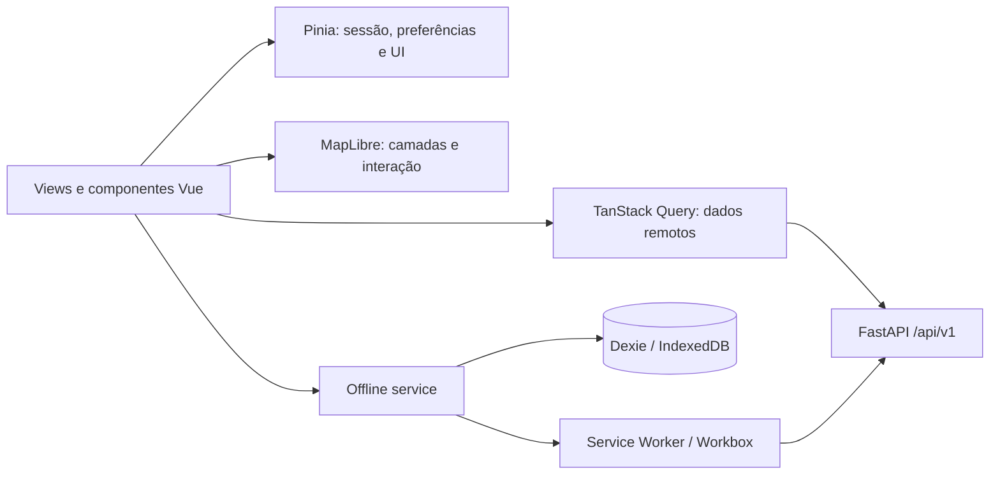
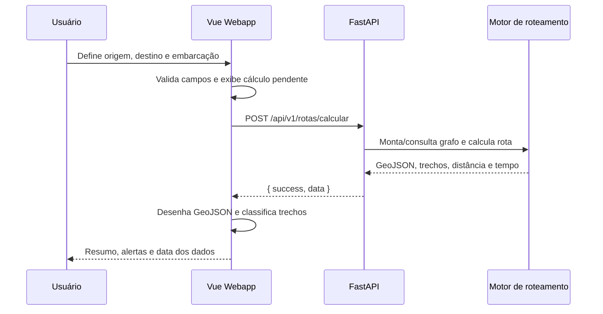

# Plano de Desenvolvimento — Webapp RotaRios / HidroWize

> Documento de referência para criar o front-end Vue 3 e integrá-lo à API existente. Não representa ainda a implementação do front-end.

## 1. Objetivo do produto

Criar um **webapp instalável (PWA)** para planejamento e consulta de rotas fluviais na Amazônia. O piloto deve conseguir, em poucos passos, selecionar origem e destino, informar parâmetros da embarcação, calcular uma rota e compreender os riscos de navegabilidade antes de iniciar a viagem.

O produto precisa funcionar tanto em navegador desktop quanto em celular/tablet, com uso degradado e transparente sem conexão. Ele é uma ferramenta de apoio ao planejamento: não substitui cartas, procedimentos operacionais ou a decisão do comandante.

### Usuários prioritários

| Perfil | Necessidades principais |
|---|---|
| Piloto/operador | Consultar nível das estações, planejar rota, avaliar trechos críticos, salvar rotas e usar dados baixados quando estiver sem conexão. |
| Administrador | Consultar a integridade do grafo, acompanhar coleta de níveis e gerenciar usuários. |

### Decisões de experiência

- O **mapa é a superfície principal**; painéis e formulários são auxiliares e não competem com ele.
- Dados críticos devem exibir **origem, data/hora de atualização e condição online/offline**.
- A rota precisa explicar seus riscos: distância, ETA, profundidade mínima conhecida, trechos críticos e dados ausentes.
- O app deve ser legível sob luz intensa, em telas pequenas e por pessoas com baixa visão.

---

## 2. Referências de interface pesquisadas

| Referência | Padrão observado | Aplicação no RotaRios |
|---|---|---|
| Aqua Map Chart Viewer | Carta limpa, consulta de objetos no mapa e sobreposições opcionais. | Mapa pouco poluído; detalhes aparecem ao selecionar estação/trecho. |
| Water Map Live | Objetos e dados operacionais organizados por camadas; waypoints editáveis e sincronização web/app. | Camadas desligáveis, painel de detalhes e rota editável/legível. |
| Boatrouting e NavShip | Busca ou toque para origem/destino; controles de enquadrar, centralizar, recálculo e resumo compacto. | Fluxo de planejamento direto e controles cartográficos recorrentes. |
| PaddleMap | Desenho/edição no mapa, desfazer, atalhos e exportação. | Edição de pontos, desfazer/refazer e atalhos no desktop como complemento aos botões visíveis. |
| Marine Route Planner | Restrições geográficas explícitas, como costa, profundidade e áreas a evitar. | Diferenciar visualmente trecho transitável, crítico, desconhecido e indisponível. |
| 长江e+ | Serviços de navegação, hidrologia, clima e avisos em categorias claras. | Navegação por tarefas: mapa, rotas, estações, alertas e administração. |

Fontes: [Aqua Map](https://www.aquamap.app/support/tutorials), [Water Map Live](https://wasserkarte.net/gids/water-map-live-questions-and-answers.php), [NavShip](https://navship.org/en/frequently-asked-questions-faq/), [PaddleMap](https://paddlemap.net/), [Marine Route Planning](https://github.com/ferhannb/marine-route-planning).

---

## 3. Stack recomendada

### Escolha principal

```text
Vue 3 + TypeScript + Vite
├── Vue Router                 rotas e guards de autenticação
├── Pinia                      estado de interface e sessão
├── TanStack Query para Vue    estado remoto, cache, retry e loading/error
├── MapLibre GL JS + Turf.js   mapa vetorial, GeoJSON e análises geográficas leves
├── Tailwind CSS               design system e responsividade
├── componentes Vue próprios   controles, dialogs, painéis e feedback acessíveis
├── Vite PWA + Workbox         instalação, service worker e cache
├── Dexie.js / IndexedDB       rotas, snapshots e fila offline
├── VueUse                     geolocalização, preferências, mídia e atalhos
└── Vitest + Playwright        testes unitários, E2E e acessibilidade
```

### Motivos

| Tecnologia | Uso no sistema | Decisão |
|---|---|---|
| Vue 3 + TypeScript | Componentes, formulários, estado e segurança de contratos da API. | Manter Vue; padronizar `script setup` e tipos explícitos. |
| Vite | Build, desenvolvimento e integração PWA. | Escolha natural para SPA Vue. |
| MapLibre GL JS | Renderização WebGL de camadas vetoriais, GeoJSON de rotas, estações, estilos e popups. | Preferencial para o mapa principal e grande volume de geometria. |
| Turf.js | Distâncias, `bbox`, validação de geometria, seleção por área e apoio à interação. | Usar apenas para operações leves; roteamento oficial continua no backend. |
| Pinia | Sessão, preferências, estado temporário de planejamento e UI. | Não duplicar dados de API no Pinia. |
| TanStack Query | Chamadas REST, invalidação, estados de carregamento e persistência controlada. | Fonte de verdade para dados remotos. |
| Tailwind CSS | Tokens, layout, breakpoints e estilos de alto contraste. | Substitui Bootstrap como base visual, sem impedir seu uso temporário durante migração. |
| Dexie / IndexedDB | Snapshot do grafo, estações, últimas leituras, rotas locais e ações pendentes. | Necessário para operação offline real. |
| Vite PWA / Workbox | Manifest, service worker, cache de assets e estratégias de requisição. | Necessário para webapp instalável. |

### Alternativa para o mapa

MapLibre GL JS deve ser validado cedo nos dispositivos-alvo, pois a versão atual exige **WebGL2**. Se houver parcela relevante de aparelhos sem suporte ou se o MVP trabalhar apenas com poucas camadas simples, Leaflet é uma alternativa aceitável. A decisão deve ser feita por um spike técnico antes de consolidar os componentes cartográficos.

### O que não usar como base

- Não usar Bootstrap como identidade visual dominante: seus componentes podem permanecer temporariamente, mas o layout final deve usar tokens e componentes próprios.
- Não usar um kit completo de interface como fonte de todas as telas; mapa, painéis flutuantes e `bottom sheets` exigem controles específicos.
- Não executar o A* de produção no navegador enquanto estiver online. O backend é a fonte de verdade; o cálculo local é somente fallback com snapshot explicitamente datado.

Referências: [Vue tooling](https://vuejs.org/guide/scaling-up/tooling), [MapLibre GL JS](https://maplibre.org/maplibre-gl-js/docs/), [Vite PWA](https://vite-pwa-org.netlify.app/guide/), [MDN PWA](https://developer.mozilla.org/en-US/docs/Web/Progressive_web_apps/Guides/Making_PWAs_installable).

---

## 4. Arquitetura do front-end



### Estrutura proposta

```text
frontend/
├── src/
│   ├── app/                 # configuração, router, providers e tokens
│   ├── assets/
│   ├── components/
│   │   ├── ui/              # Button, Input, Dialog, Toast, Skeleton, Badge
│   │   ├── map/             # RiverMap, MapControls, LayerPanel, RouteLayer
│   │   ├── route/           # RoutePlanner, RouteSummary, CriticalSegments
│   │   └── stations/        # StationPopup, StationDetail, LevelChart
│   ├── composables/         # useMap, useAccessibility, useConnectivity
│   ├── db/                  # schema Dexie e repositórios locais
│   ├── features/            # auth, map, route, stations, offline, admin
│   ├── layouts/
│   ├── services/            # api client, endpoints, websocket, sync
│   ├── stores/              # auth, UI, preferences; sem dados de servidor
│   ├── styles/              # tokens CSS, Tailwind e estilos globais
│   ├── types/               # contratos TypeScript da API
│   └── views/
├── public/
├── vite.config.ts
└── package.json
```

### Responsabilidades de estado

| Tipo | Tecnologia | Exemplos |
|---|---|---|
| Remoto/cacheável | TanStack Query | Estações, níveis, rota calculada, status do grafo, histórico. |
| Global de interface | Pinia | Usuário, token em memória, tema, contraste, tamanho de texto, painel aberto. |
| Local persistente | IndexedDB | Snapshot offline, rotas criadas offline, fila de sincronização, metadados de download. |
| Local do componente | `ref`, `computed` | Campo em edição, popup aberto, waypoint sendo arrastado. |

---

## 5. Navegação e telas

### Rotas iniciais

| Rota | Finalidade | Permissão |
|---|---|---|
| `/login` | Autenticação online. | Pública |
| `/mapa` | Mapa, camadas, estações e entrada do planejamento. | Pública para consulta; recursos privados condicionais. |
| `/rotas/nova` | Planejador de rota. | Consulta pública enquanto o endpoint permitir; salvar exige login. |
| `/rotas/:id` | Resultado, trechos críticos e monitoramento. | Dono/admin quando houver persistência. |
| `/historico` | Rotas salvas pelo usuário. | Autenticado |
| `/estacoes/:codigo` | Detalhe e série de nível. | Consulta do resumo pública; série conforme API. |
| `/configuracoes` | Tema, contraste, fonte, offline e privacidade. | Pública/local |
| `/admin/*` | Usuários, coleta e integridade de dados. | Admin |

### Layout desktop

```text
┌──────────────────────────────────────────────────────────────────┐
│ marca | busca | estado: online/atualizado | acessibilidade | perfil│
├──────────────┬───────────────────────────────────────────────────┤
│ painel       │                                                   │
│ planejamento │                     MAPA                          │
│ camadas      │         controles de zoom/localização             │
│ estações     │         rota, marcadores e legenda                │
│ rotas        │                                                   │
├──────────────┴───────────────────────────────────────────────────┤
│ resumo da rota: distância | ETA | profundidade | alertas | ação  │
└──────────────────────────────────────────────────────────────────┘
```

### Layout mobile

- Cabeçalho compacto com busca e botão de menu.
- Mapa ocupa a tela; controles são flutuantes e têm alvo mínimo de 44 × 44 px.
- Planejamento, camadas e resumo usam `bottom sheet` arrastável, não sidebar reduzida.
- O resumo da rota permanece acessível sem ocultar toda a área cartográfica.
- A barra inferior contém apenas ações frequentes: mapa, planejar, rotas e configurações.

### Fluxo de cálculo de rota

1. Usuário pesquisa ou seleciona origem e destino no mapa.
2. Painel mostra os parâmetros: calado, margem de segurança, velocidade e opção de monitorar.
3. Validação ocorre antes de enviar; valores e unidades ficam sempre explícitos.
4. Em rede, o front envia o pedido ao backend e mostra estado de cálculo sem bloquear o mapa.
5. Ao receber o GeoJSON, desenha a rota, enquadra-a sem remover o controle do usuário e abre o resumo.
6. Trechos críticos, desconhecidos e intransitáveis possuem cor, padrão, ícone e texto — nunca somente cor.
7. Em modo offline, o app informa a data do snapshot e somente oferece cálculo se o trecho estiver baixado.

---

## 6. Design system e acessibilidade

### Tokens visuais

- Cores semânticas: `surface`, `text`, `primary`, `success`, `warning`, `danger`, `info`, `unknown`.
- Tema claro, escuro e alto contraste; a seleção é persistida localmente.
- Escala de texto: 100%, 125%, 150% e 200%; componentes devem refluír sem corte.
- Tipografia legível, pesos suficientes e números tabulares para distância, cota e horário.
- Espaçamento baseado em escala fixa; sem depender de valores isolados em componentes.

### Requisitos obrigatórios

| Tema | Critério de aceite |
|---|---|
| Contraste | Texto normal com contraste mínimo 4,5:1; texto grande e elementos de interface com critérios WCAG AA. |
| Teclado | Todas as ações, popups e dialogs funcionam por teclado; foco é evidente e nunca fica oculto. |
| Leitor de tela | Botões de ícone têm nome acessível; alterações de rota, erro e sincronização são anunciadas por região `aria-live`. |
| Mapa | Há uma lista textual alternativa para estações, alertas e trechos da rota; o mapa não é a única forma de acessar o dado. |
| Movimento | Respeitar `prefers-reduced-motion`; não usar animações contínuas para indicar dados críticos. |
| Cor | Alertas combinam cor, forma/padrão e rótulo. |
| Toque | Alvos de toque mínimos de 44 × 44 px e espaçamento contra toques acidentais. |

### Heurísticas de Nielsen Norman aplicadas

| Heurística | Aplicação concreta |
|---|---|
| Visibilidade do estado | Mostrar carregando, “offline”, última atualização, fonte do dado e status da sincronização. |
| Correspondência com o mundo real | Usar vocabulário de navegação fluvial e unidades claras (`m`, `km`, `km/h`, data/hora local). |
| Controle e liberdade | Cancelar planejamento, remover ponto, desfazer/refazer e restaurar visualização do mapa. |
| Consistência | Mesmos ícones e cores semânticas em mapa, listas, toasts e detalhes. |
| Prevenção de erro | Alertar sobre calado inválido, dados antigos, trechos sem profundidade e rota não disponível antes da confirmação. |
| Reconhecimento | Legenda visível, chips de filtros ativos e histórico de buscas/rotas. |
| Recuperação de erro | Mensagem com causa e próxima ação: “Não foi possível calcular; tente reduzir o calado ou escolher outro trecho”. |

Referência: [10 heurísticas de usabilidade — NN/g](https://www.nngroup.com/articles/ten-usability-heuristics/).

---

## 7. Integração com o backend

### Situação verificada no repositório

O backend FastAPI já possui uma primeira API em `backend/main.py`. Ela expõe autenticação, usuários, estações, série de níveis, status do grafo e cálculo de rota. Não há, no código atual, persistência de rotas, sincronização offline, WebSocket ou monitoramento de rota; a coleta manual responde `501` porque ainda depende de serviço agendado.

**Base URL local:** `http://localhost:8000/api/v1`  
**Documentação:** `http://localhost:8000/api/v1/docs`  
**Saúde:** `GET http://localhost:8000/health`

### Endpoints existentes a integrar primeiro

| Método e rota | Autenticação | Uso no front |
|---|---|---|
| `POST /auth/login` | Não | Iniciar sessão e obter JWT. |
| `GET /auth/me` | Bearer | Restaurar usuário ao abrir o app. |
| `GET /estacoes` | Não | Camada de estações, busca de origem/destino e lista alternativa. |
| `GET /estacoes/{codigo}` | Não | Popup e cabeçalho da estação. |
| `GET /niveis` | Bearer | Série temporal e gráfico de nível. |
| `GET /grafo/status` | Não no código atual | Diagnóstico técnico e tela administrativa. |
| `POST /rotas/calcular` | Não no código atual | Fluxo central de planejamento. |
| `GET/POST/PUT/DELETE /usuarios` | Admin | Administração de usuários. |

### Contratos TypeScript mínimos

```ts
type ApiSuccess<T> = { success: true; data: T }
type ApiError = { success: false; error: { code: string; message: string } }

type RouteRequest = {
  origem_nome: string
  destino_nome: string
  calado_m: number
  margem_seguranca_m: number
  velocidade_embarcacao_kmh: number
  monitorar?: boolean // ainda não consumido pela implementação atual
}

type RouteResult = {
  rota_id: number | null
  origem: string
  destino: string
  distancia_total_km: number
  tempo_total_h: number
  custo_total: number
  trechos_criticos: number
  profundidade_minima_m: number | null
  geojson: GeoJSON.FeatureCollection
  items: Array<{
    no_origem: string
    no_destino: string
    fid: string | number
    distancia_km: number
    profundidade_m: number | null
    transitavel: boolean
    tempo_h: number
  }>
}
```

### Cliente HTTP

- Criar um único cliente em `services/http.ts` com `baseURL` por variável `VITE_API_BASE_URL`.
- Anexar `Authorization: Bearer <token>` somente quando houver sessão.
- Converter respostas `{ success, data }` em retorno tipado e converter `{ success: false, error }` em erro de domínio.
- Para `401`, limpar sessão e pedir login sem descartar rota que esteja em edição.
- Para erro de rede, usar dados persistidos se disponíveis e informar claramente o estado offline.
- Não registrar JWT, senha ou dados sensíveis em console, analytics ou IndexedDB sem proteção.

### Ajustes necessários no contrato de API

| Prioridade | Ajuste solicitado ao backend | Motivo de interface |
|---|---|---|
| Alta | Definir se `/rotas/calcular` é público ou exige JWT e manter a decisão documentada. | O front precisa saber se pode oferecer planejamento anônimo. |
| Alta | Retornar `atualizado_em`/fonte para profundidades e insumos usados no cálculo. | Permite informar validade e confiabilidade da rota. |
| Alta | Padronizar unidades, `null` e timestamps ISO 8601 com timezone em todas as respostas. | Evita conversões inseguras no mapa e nas telas. |
| Alta | Publicar CORS para a URL do Vite em desenvolvimento e para o domínio final em produção. | Permite comunicação segura do navegador. |
| Média | Implementar `GET/POST /rotas` para histórico e rotas salvas. | Necessário para “Minhas rotas”. |
| Média | Implementar `/sync/snapshot` e `/sync/push`, com versão do snapshot e ETag. | Necessário para uso offline e resolução de conflito. |
| Média | Implementar WebSocket ou SSE autenticado para `nivel_atualizado` e `rota_alterada`. | Atualização em tempo real sem polling excessivo. |
| Média | Converter `POST /niveis/coletar` em tarefa assíncrona acompanhável. | A tela admin precisa de status real, não um `501`. |
| Baixa | Fornecer geometrias/simplificações por zoom ou tiles vetoriais. | Garante desempenho ao escalar para muitos trechos. |

### Integração de rota



---

## 8. Offline, sincronização e PWA

### Dados que podem ser cacheados

| Dado | Estratégia | Limite/observação |
|---|---|---|
| Shell do app (JS, CSS, fontes, ícones) | Precache na instalação. | Atualização controlada por banner “nova versão disponível”. |
| Estações e leituras recentes | `stale-while-revalidate`. | Guardar horário de sincronização. |
| Snapshot do grafo por área | Download explícito do usuário. | Informar tamanho, cobertura e validade antes de baixar. |
| Rotas calculadas | IndexedDB por usuário/dispositivo. | Marcar se calculada online ou offline. |
| Fila de ações | Persistência local e reenvio idempotente. | Exibir falha e opção de reenviar/remover. |

### Tabelas IndexedDB propostas

```text
app_meta            versão do schema, preferência e última sincronização
stations            estações por área
levels              leituras e data de validade
graph_snapshots     grafo/versionamento/cobertura geográfica
routes_local        rotas locais e seus parâmetros
pending_operations  fila de sincronização com idempotency key
sync_log            resultado de pull/push e erros recuperáveis
```

### Regras de segurança e transparência

- O app nunca apresentará dado cacheado como “ao vivo”.
- Cada rota offline mostra: área baixada, versão do snapshot e horário da última sincronização.
- Apenas dados necessários devem ser mantidos no dispositivo; oferecer “limpar dados offline” nas configurações.
- Tokens não devem ser inseridos em URLs. A estratégia de persistência do token deve ser definida com o backend; preferir cookie `HttpOnly` quando a arquitetura permitir.
- O PWA deve funcionar em HTTPS; localização é solicitada somente ao acionar “minha posição”.

---

## 9. Plano de execução por fases

| Fase | Entregáveis | Dependências | Critério de aceite |
|---|---|---|---|
| 0 — Fundação | Projeto Vue/Vite/TS, lint, testes, variáveis de ambiente, Tailwind, tokens e router. | Nenhuma. | Build, lint e testes executam; tema e escala de fonte persistem. |
| 1 — API e sessão | Cliente HTTP tipado, login, restauração de sessão, tratamento de `401` e erro de rede. | API local disponível. | Login e logout funcionam; erros não expõem dados sensíveis. |
| 2 — Mapa exploratório | Spike MapLibre, mapa base, estações, busca, popup, lista textual e camadas. | `GET /estacoes`. | Estações aparecem e podem ser encontradas por mouse, toque e teclado. |
| 3 — Planejamento de rota | Formulário, seleção origem/destino, chamada de cálculo, GeoJSON, resumo e trechos críticos. | `POST /rotas/calcular`. | Uma rota é calculada, desenhada e explicada em até o limite real do backend. |
| 4 — Níveis e detalhes | Série temporal, indicadores de atualização, filtros e estados vazios/erro. | `GET /niveis`. | O usuário entende o nível, período e data da última leitura. |
| 5 — PWA/offline básico | Manifest, SW, cache do app, conectividade e aviso offline. | Fases 0–4. | App instala e abre offline com shell e dados já visitados. |
| 6 — Offline completo | Dexie, download de área, snapshot, cálculo local, fila e sincronização. | Endpoints `/sync/*` definidos. | Rota em área baixada funciona sem rede e sincroniza depois. |
| 7 — Rotas salvas e alertas | Histórico, monitoramento, SSE/WS ou polling, notificações internas. | Persistência de rotas e eventos no backend. | Mudança de rota é recebida e explicada ao usuário. |
| 8 — Administração | Usuários, status do grafo e coleta assíncrona. | Endpoints admin completos. | Acesso por papel, feedback de tarefa e log auditável. |
| 9 — Qualidade e publicação | Testes E2E, acessibilidade, performance, observabilidade e deploy HTTPS. | Todas as fases anteriores. | Critérios RNF e checklist de lançamento atendidos. |

### Ordem de valor para o MVP

1. Fundação + mapa com estações.
2. Cálculo e visualização de rota online.
3. Estados de confiabilidade e acessibilidade.
4. PWA com cache básico.
5. Histórico e offline completo.
6. Monitoramento em tempo real e administração avançada.

---

## 10. Estratégia de testes e qualidade

| Camada | Ferramenta | Cenários mínimos |
|---|---|---|
| Unidade | Vitest | Formatação de unidades, mapeamento de erro da API, cálculo de estado de risco, stores e composables. |
| Componentes | Vitest + Testing Library | Labels, foco, dialog, `aria-live`, formulário e painel de rota. |
| E2E | Playwright | Login, busca de estação, cálculo, erro de rota, offline, preferência de contraste e escala de fonte. |
| Acessibilidade | axe-core no Playwright + revisão manual | Teclado, contraste, leitor de tela e zoom de 200%. |
| Desempenho | Lighthouse + métricas reais | Carregamento inicial, interação do mapa e uso de memória em aparelhos-alvo. |
| Contrato | Schemas TypeScript/Zod e testes de API | Detectar quebra de campos, unidade ou enumeração antes do deploy. |

### Metas iniciais

- Interface utilizável em 360 px de largura e desktop a partir de 1280 px.
- Sem corte de conteúdo em texto a 200%.
- Primeira tela significativa em até 3 s em rede 4G de referência, após otimização dos assets cartográficos.
- Cálculo de rota com feedback imediato; se ultrapassar 5 s, mostrar progresso/estado e permitir cancelar uma nova tentativa.
- Nenhum erro crítico de teclado ou contraste nos fluxos principais.

---

## 11. Riscos e decisões pendentes

| Risco/decisão | Impacto | Ação antes de construir |
|---|---|---|
| Datum vertical entre nível ANA e cota de fundo | Pode tornar profundidade e alerta inseguros. | Validar regra e fonte com domínio/orientação técnica; sinalizar incerteza no front. |
| Cobertura e peso das geometrias | Pode degradar mapa em dispositivos modestos. | Fazer spike MapLibre com trecho real, simplificação e medição de FPS/memória. |
| Autorização de cálculo e dados públicos | Afeta fluxo de login e cache. | Formalizar matriz de permissões na API. |
| Offline de dados cartográficos | Pode ocupar muito armazenamento e ficar desatualizado. | Definir áreas baixáveis, tamanho máximo, expiração e política de atualização. |
| Eventos em tempo real | WebSocket pode falhar em redes restritas. | Projetar SSE/polling como fallback e preservar notificações pendentes. |
| Dados críticos desatualizados | Risco operacional. | Exibir validade, fonte e limitação de todos os dados relevantes. |

---

## 12. Checklist antes de iniciar a implementação

- [ ] Confirmar nome final do produto: **RotaRios** ou **HidroWize**.
- [ ] Escolher MapLibre após spike técnico com dados reais; definir fallback caso necessário.
- [ ] Confirmar domínio e configuração de CORS para dev, homologação e produção.
- [ ] Validar os contratos atuais no Swagger e gerar/adotar tipos TypeScript.
- [ ] Definir se rota anônima será permitida e como ocorrerá o salvamento de rota.
- [ ] Formalizar versão, cobertura e expiração do snapshot offline.
- [ ] Validar datum e regras de profundidade/navegabilidade antes de apresentar afirmações de segurança ao piloto.
- [ ] Definir identidade visual, logotipo e nomenclatura de domínio.
- [ ] Selecionar dispositivos reais para teste de WebGL2, GPS, modo offline e acessibilidade.
