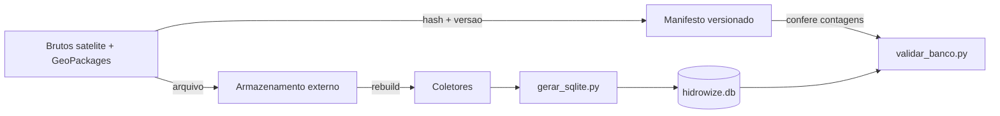

# Plano — Suprir as Lacunas do Passo 1 (Dados e Reprodutibilidade)

Plano de ação para tornar o banco consolidado `data/hidrowize.db` integralmente reproduzível a partir de fontes arquivadas, incluindo os produtos de satélite — em especial a vazão SWOT.

---

## 1. Objetivo

Garantir que qualquer pessoa (banca, orientador ou outro desenvolvedor) consiga **reconstruir integralmente o banco de dados** a partir de fontes controladas, sem depender de arquivos que só existem em uma máquina local, e sem perder a proveniência dos dados de satélite.

Resultados esperados:

- O comando de reconstrução gera as 16 tabelas com as mesmas contagens registradas.
- Os produtos brutos de satélite (vazão e batimetria) ficam preservados e identificáveis por versão/hash.
- Existe um procedimento de reconstrução testado e documentado.

---

## 2. Diagnóstico das Lacunas

| ID | Lacuna | Evidência | Impacto |
|----|--------|-----------|---------|
| L1 | NetCDF de vazão SWOT ausente | Não existe `data/satelite/vazao/sa_*.nc`; `gerar_sqlite.py:398-401` retorna 0 quando a pasta não existe | `series_vazao_satelite` (475.111 linhas) não é regenerável sem novo download |
| L2 | Nenhum dado versionado | `.gitignore` ignora `data/` (GeoPackage, NetCDF, banco de 820 MB) | Em clone limpo, o passo 1 exige rodar todos os coletores novamente |
| L3 | Proveniência não registrada | Não há hash/versão dos produtos SICFLOW e SOS Discharge, nem data de coleta | Impossível garantir que uma reconstrução seja idêntica à atual |
| L4 | Sem validação automatizada | Não existe script que confirme as contagens do banco após reconstrução | Erros de reconstrução passam despercebidos |

Observação: a pasta `data/satelite/batimetria/` ainda contém o NetCDF SICFLOW (490 MB), mas isso é circunstancial; o fluxo normal do coletor remove os brutos após importar (`_limpar_subpasta`).

---

## 3. Estratégia

Princípios adotados:

1. **O banco é a fonte de verdade**; os brutos são insumos de reconstrução.
2. **Dados pesados não entram no Git** — permanecem em armazenamento externo.
3. **Todo bruto tem hash e versão** registrados em um manifesto versionado.
4. **Reconstrução é validada por script**, não por inspeção manual.

---

## 4. Plano de Ação

### Fase A — Preservação das Fontes Brutas

| ID | Tarefa | Tipo | Esforço | Depende de |
|----|--------|------|---------|------------|
| T1 | Rebaixar os produtos de satélite (vazão, batimetria, estações) com `coletar_hydroweb.py --tudo --forcar` | Execução | 1 h + download | API key HYDROWEB |
| T2 | Adicionar opção `--manter-brutos` ao coletor para não apagar os NetCDF (`backend/coletar_hydroweb.py`) | Código | 1–2 h | T1 |
| T3 | Arquivar os brutos (NetCDF e GeoPackages) em armazenamento externo organizado por data/versão | Infra | 1 h + upload | T1, T2 |

Detalhes:

- **T1**: o download da vazão SWOT é grande (~1,76 GB) e a batimetria SICFLOW tem ~490 MB. Validar espaço em disco antes. Confirmar `HYDROWEB_API_KEY` no `.env`.
- **T2**: hoje `comando_vazao` e `comando_batimetria` chamam `_limpar_subpasta` ao final, removendo o NetCDF. A nova opção deve pular essa limpeza, preservando o arquivo para reconstrução.
- **T3**: destino sugerido — Drive institucional ou storage de objetos, pasta `satelite/<AAAA-MM>/`, contendo os `.nc`, os `.gpkg` de hidrovias e os zips originais.

### Fase B — Proveniência e Validação

| ID | Tarefa | Tipo | Esforço | Depende de |
|----|--------|------|---------|------------|
| T4 | Criar manifesto de fontes com hash SHA-256, versão, bbox, data de coleta e contagens | Documentação | 2 h | T1 |
| T5 | Criar `backend/validar_banco.py` (tabelas esperadas, contagens mínimas, integridade) | Código | 3–4 h | — |

Detalhes:

- **T4**: gerar `Get-FileHash` (SHA-256) para cada bruto e registrar em `planilhas/satelite_manifest.csv` (versionado) ou `docs/specs/fontes-satelite.md`. Campos: produto, collection ID, versão/data, tamanho, SHA-256, origem (URL STAC), contagem no banco.
- **T5**: o validador deve verificar no mínimo: presença das 16 tabelas, `trechos_navegaveis = 121.661`, `batimetria_sicflow = 1.315.079`, `series_nivel_satelite = 590.698`, `series_vazao_satelite = 475.111`, `cota_fundo_trecho = 121.661`, `estacoes = 75`, e ausência de valores obrigatórios nulos nas chaves.

### Fase C — Reconstrução e Verificação

| ID | Tarefa | Tipo | Esforço | Depende de |
|----|--------|------|---------|------------|
| T6 | Escrever runbook de reconstrução (ordem e comandos exatos) | Documentação | 2 h | T2, T5 |
| T7 | Testar a reconstrução em diretório limpo e comparar com o manifesto | Verificação | 3–4 h + downloads | T3, T4, T6 |
| T8 | Atualizar `estado-atual-projeto.md` e os comentários do `.gitignore` | Documentação | 0,5 h | T7 |

Detalhes:

- **T6**: sequência esperada — coletores ANA (telemetria, cotas, decretos) → `coletar_hydroweb.py` (satélite) → `gerar_sqlite.py` → `validar_banco.py`. Registrar também de onde vêm os GeoPackages de hidrovias.
- **T7**: apagar/renomear o `hidrowize.db`, rodar o runbook do zero e conferir cada contagem contra o manifesto. Evidência de aceite: saída do `validar_banco.py` marcando OK.
- **T8**: marcar a lacuna L1–L4 como resolvida e registrar a decisão sobre versionamento.

---

## 5. Cronograma Sugerido

| Etapa | Tarefas | Duração estimada | Marco |
|-------|---------|------------------|-------|
| Fase A | T1–T3 | 1 dia (+ tempo de download) | Brutos preservados e arquivados |
| Fase B | T4–T5 | 1 dia | Manifesto e validador prontos |
| Fase C | T6–T8 | 1 dia (+ download) | Reconstrução verificada em ambiente limpo |

O caminho crítico é o download dos produtos de satélite (T1); as demais tarefas podem ser adiantadas em paralelo quando não dependem dele.

---

## 6. Critérios de Aceite do Passo 1

- CA1: Existe backup externo dos NetCDF de vazão e batimetria, com hash registrado.
- CA2: `gerar_sqlite.py`, executado do zero, reconstrói as 16 tabelas com contagens iguais ou superiores às do manifesto.
- CA3: `series_vazao_satelite` é reconstruída sem depender do banco antigo.
- CA4: `validar_banco.py` retorna sucesso e lista as contagens conferidas.
- CA5: O runbook foi executado em diretório limpo por um segundo ambiente, com resultado igual ao registrado.
- CA6: Nenhum insumo indispensável existe apenas na máquina local de origem.

---

## 7. Riscos e Mitigação

| ID | Risco | Probabilidade | Mitigação |
|----|-------|---------------|-----------|
| R1 | Download lento/instável da vazão SWOT (~1,76 GB a ~1 MB/s) | Alta | Baixar uma única vez e arquivar; permitir retomada |
| R2 | Expiração/limite da API key do hydroweb.next | Média | Validar antes de T1; manter o bruto para não depender de novo acesso |
| R3 | Nova versão do produto SICFLOW/SOS altera contagens | Média | Fixar versão e hash no manifesto; tratar contagem esperada como referência da versão |
| R4 | Espaço em disco insuficiente (~2,7 GB satélite + ~2,25 GB GeoPackages) | Média | Arquivar em storage externo; compactar |
| R5 | Auto-limpeza apagar o bruto novamente | Alta se T2 não for feito | Implementar `--manter-brutos` antes de rebaixar |
| R6 | Banco de 820 MB não versionado | Certo | Documentar como artefato regenerável; nunca tratá-lo como fonte primária |

---

## 8. Decisões Pendentes

- Definir o **destino do armazenamento externo** dos brutos (Drive institucional, objeto/S3 ou HD externo).
- Decidir se os CSVs compactos (`series_nivel_satelite.csv`, ~54 MB) serão versionados via Git LFS ou mantidos fora do repositório.
- Fixar e registrar a **versão do SICFLOW** (v1/2026) e do SOS Discharge usados, por hash.
